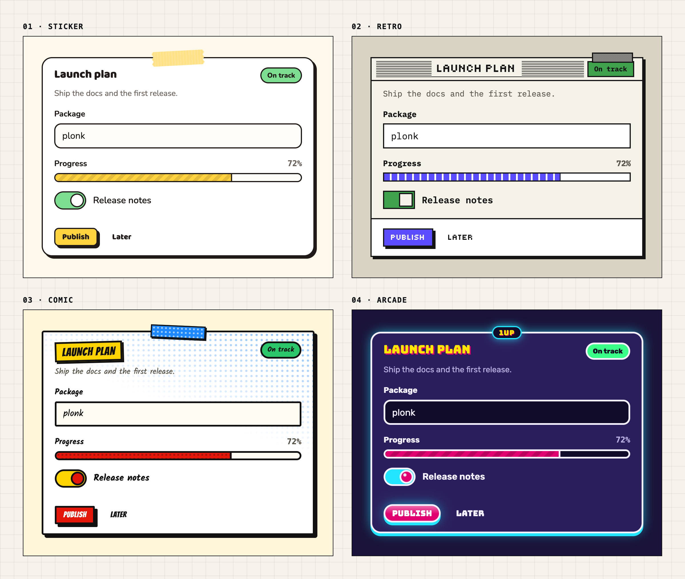

<div align="center">


# Plonk

**Neo-brutalist React components with switchable personalities.**

_Same components, four personalities, each with its own look and motion._

**[📖 Documentation](__DOCS_URL__/docs)** · **[🎨 Theme builder](__DOCS_URL__/docs/theme-builder)** · **[📦 npm](https://www.npmjs.com/package/plonk)**

[](https://www.npmjs.com/package/plonk)


</div>

<p align="center"></p>

---

## About

**Plonk** is a React component library in the neo-brutalist style: thick borders, hard shadows, flat and bright colors. Its distinctive idea is **switchable personalities**. One prop changes not only how every component looks but also how it moves: a jelly that wobbles when pressed, a window that opens in stepped frames, a "POW!" where you click, points flying off a button.

```jsx
<PlonkProvider personality="sticker">  {/* the default */}
<PlonkProvider personality="retro">
```

I built it as a **portfolio project**, to show what goes into a real design system: tokens, a motion system, accessibility, docs and a theme builder. It's complete and usable, but **not actively supported**: issues and pull requests may go unanswered.

## Features

- **Four personalities:** Sticker, Retro, Comic and Arcade. Switch them for the whole app or a single section, and nest them.
- **A motion language per personality:** springs are simulated and turned into CSS `linear()` curves, so most motion runs on CSS alone at 60fps.
- **Accessible by default:** interactive components are built on [React Aria](https://react-spectrum.adobe.com/react-aria/): keyboard, focus management and screen reader support come built in.
- **Reduced motion done properly:** with the system setting or `motion="reduce"`, motion becomes calmer, not absent.
- **Themeable with tokens:** every color, border, shadow, radius, font and motion value is a `--plonk-*` CSS variable. Typed in TypeScript, too.
- **A theme builder:** tweak a personality in the browser and copy only the tokens you changed.
- **A data table:** sorting, filters, column management, bulk selection and virtual scrolling, on TanStack Table.
- **Localization:** dates, numbers and screen reader texts follow the `locale` you give (sorting and search too, including Turkish `i` / `ı`).
- **Fonts included:** the fonts of all four personalities ship with the package; a browser only downloads the ones a page uses.
- **Works with Server Components:** the package ships with `"use client"`; import components straight into a Next.js page.

## Personalities

| Personality | Code name | Character                                                                                          |
| ----------- | --------- | -------------------------------------------------------------------------------------------------- |
| **Sticker** | `sticker` | Notebook lines, tape and stickers. Things are stuck on at a slight tilt and wobble like jelly.     |
| **Retro**   | `retro`   | Every component is a window with a title bar. Pixel font, stepped and instant motion.              |
| **Comic**   | `comic`   | Thick ink and halftone dots. "POW!" and "ZAP!" where you click; dialogs are speech bubbles.        |
| **Arcade**  | `arcade`  | The dark one. Dome buttons, neon glow, points flying off buttons and a "CONTINUE? 9…8…" countdown. |

## Installation

**Requirements:** React 19 and Tailwind CSS 4.1+. Plonk is an ES module package; use it with a bundler or a framework (Next.js, Vite, Remix).

```bash
npm install plonk
```

In the CSS file where you import Tailwind, add Plonk's theme and let Tailwind scan the package for classes:

```css
@import "tailwindcss";
@import "plonk/theme.css";
/* Path from this CSS file to node_modules */
@source "../node_modules/plonk/dist";
```

## Quick start

Wrap your app once with `PlonkProvider`. It sets the personality and opens the region where toasts appear.

```tsx
import { Button, Card, PlonkProvider, Switch, toast } from "plonk";

export function App() {
  return (
    <PlonkProvider personality="sticker">
      <Card title="Notifications">
        <div className="flex flex-col gap-4">
          <Switch label="Email me about replies" defaultChecked />
          <Button onPress={() => toast.success("Settings saved")}>Save</Button>
        </div>
      </Card>
    </PlonkProvider>
  );
}
```

Components also render without a provider (as Sticker), but toasts won't appear and there's no personality, motion or locale setting. See [Installation](__DOCS_URL__/docs/installation) for Next.js and more.

## Theming

Every design decision is a token. Override them for all personalities, for one, or for a single section:

```css
[data-plonk-personality="sticker"] {
  --plonk-color-primary: #ff8cc6;
  --plonk-color-on-primary: #0f1115;
  --plonk-radius-md: 4px;
  --plonk-jelly-amount: 0.4;
}
```

Or pass them to a provider. The `style` prop is typed, so token names autocomplete and typos are caught:

```tsx
<PlonkProvider style={{ "--plonk-color-focus": "#2f5bff" }}>…</PlonkProvider>
```

The [theme builder](__DOCS_URL__/docs/theme-builder) writes this code for you. See [Colors](__DOCS_URL__/docs/colors), [Fonts](__DOCS_URL__/docs/fonts), [Tokens](__DOCS_URL__/docs/tokens) and [Motion](__DOCS_URL__/docs/motion).

## Components

| Group     | Components                                                                                                                                                                                                                                                                                                                                                    |
| --------- | ------------------------------------------------------------------------------------------------------------------------------------------------------------------------------------------------------------------------------------------------------------------------------------------------------------------------------------------------------------- |
| Forms     | [Button](__DOCS_URL__/docs/components/button) · [Input](__DOCS_URL__/docs/components/input) · [Textarea](__DOCS_URL__/docs/components/textarea) · [Checkbox](__DOCS_URL__/docs/components/checkbox) · [Radio Group](__DOCS_URL__/docs/components/radio-group) · [Switch](__DOCS_URL__/docs/components/switch) · [Slider](__DOCS_URL__/docs/components/slider) |
| Display   | [Card](__DOCS_URL__/docs/components/card) · [Badge](__DOCS_URL__/docs/components/badge) · [Avatar](__DOCS_URL__/docs/components/avatar) · [Progress](__DOCS_URL__/docs/components/progress) · [Kbd](__DOCS_URL__/docs/components/kbd)                                                                                                                         |
| Overlays  | [Dialog](__DOCS_URL__/docs/components/dialog) · [Drawer](__DOCS_URL__/docs/components/drawer) · [Popover](__DOCS_URL__/docs/components/popover) · [Tooltip](__DOCS_URL__/docs/components/tooltip) · [Toast](__DOCS_URL__/docs/components/toast)                                                                                                               |
| Selection | [Menu](__DOCS_URL__/docs/components/menu) · [Select](__DOCS_URL__/docs/components/select) · [Combo Box](__DOCS_URL__/docs/components/combo-box) · [Date Picker](__DOCS_URL__/docs/components/date-picker) · [Command Palette](__DOCS_URL__/docs/components/command-palette)                                                                                   |
| Structure | [Tabs](__DOCS_URL__/docs/components/tabs) · [Accordion](__DOCS_URL__/docs/components/accordion)                                                                                                                                                                                                                                                               |
| Data      | [Data Table](__DOCS_URL__/docs/components/data-table)                                                                                                                                                                                                                                                                                                         |

## Accessibility and localization

- Dialogs, menus, selects, date pickers and other interactive components follow WAI-ARIA patterns through React Aria. Simple controls (inputs, checkboxes, switches) are native HTML elements.
- Decorative extras (tape, press effects, Arcade's numbering) are hidden from screen readers.
- Reduced motion is respected from the system setting, or forced with `<PlonkProvider motion="reduce">`.
- Give the provider a `locale` (e.g. `locale="tr-TR"`). Without one, components follow the **browser's language**: placeholders and date formats may differ from your page's language.

More in [Accessibility](__DOCS_URL__/docs/accessibility) and [Localization](__DOCS_URL__/docs/localization).

## Tech stack

| Area                    | Tools                                                                                                      |
| ----------------------- | ---------------------------------------------------------------------------------------------------------- |
| UI                      | [React 19](https://react.dev)                                                                              |
| Styling                 | [Tailwind CSS 4](https://tailwindcss.com) + CSS variables                                                  |
| Behavior, accessibility | [React Aria Components](https://react-spectrum.adobe.com/react-aria/)                                      |
| Data table              | [TanStack Table](https://tanstack.com/table) + [TanStack Virtual](https://tanstack.com/virtual)            |
| Dates                   | [`@internationalized/date`](https://react-spectrum.adobe.com/internationalized/date/)                      |
| Build                   | [tsup](https://tsup.egoist.dev) (ESM + type definitions)                                                   |
| Tests                   | [Vitest](https://vitest.dev) + Testing Library                                                             |
| Docs                    | [Next.js 16](https://nextjs.org) + MDX + [Shiki](https://shiki.style)                                      |
| Monorepo, releases      | pnpm workspaces + [Turborepo](https://turbo.build), [Changesets](https://github.com/changesets/changesets) |

## Development

**Requirements:** Node.js 22+ and pnpm.

```bash
git clone https://github.com/melihfidandev/plonk-ui.git
cd plonk-ui
pnpm install
pnpm dev   # docs site on http://localhost:3000
```

The docs site uses the library's source directly, so changes show up without a build.

| Command                        | Description                                          |
| ------------------------------ | ---------------------------------------------------- |
| `pnpm dev`                     | Start the docs site                                  |
| `pnpm build`                   | Build the library and the docs                       |
| `pnpm test`                    | Run the tests                                        |
| `pnpm lint` / `pnpm typecheck` | Lint and type check                                  |
| `pnpm --filter plonk tokens`   | Regenerate the personality CSS from the token source |

```
plonk-ui/
├── packages/plonk/          # the library published to npm
│   └── src/
│       ├── components/      # every component, one folder each
│       ├── provider/        # PlonkProvider
│       ├── tokens/          # personalities (single source), easing, contrast
│       ├── motion/          # jelly and press effects
│       ├── fonts/           # bundled font files and their licenses
│       └── theme.css        # Tailwind mapping, utilities, keyframes
└── apps/docs/               # the documentation site (Next.js)
```

## License

[MIT](https://github.com/melihfidandev/plonk-ui/blob/main/LICENSE) © 2026 Melih Fidan

The bundled fonts (Baloo 2, Nunito, Tiny5, IBM Plex Mono, Bangers, Kalam, Bungee, Rubik) are licensed under the [SIL Open Font License](https://openfontlicense.org); their license files ship next to them in `dist/fonts`.
